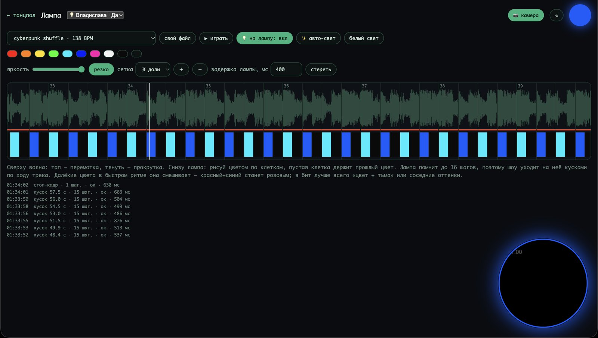

# Светошоу для умной лампочки

Свет под музыку на обычной умной лампочке, без перепрошивки и без отвязки от Алисы. Выбираешь трек, жмёшь «✨ авто-свет», и лампа мигает в долю. Шоу можно дорисовать руками на сетке, как в музыкальном редакторе.

*Light show for a smart bulb, synced to music via the smart home cloud API, with no flashing and no Matter re-pairing. It works because of an undocumented custom-scene format, described below.*



Идею подсмотрел в [рилсе](https://www.instagram.com/reels/DfW0t_lIuP3/), где автор навайбкодил редактор света для своей люстры. Здесь то же самое, только для умной лампочки.

## Что умеет

- **Авто-свет по разбору трека.** Для треков из [`web/tracks.json`](web/tracks.json) заранее найдены доли, энергия каждого такта и смены частей. Тихие такты дают медленный перелив, средние — цвет на каждую долю, мощные — вспышку в долю и тьму между. На смене части — белая вспышка и новая пара цветов.
- **Ручной редактор.** Рисуешь цветом по клеткам: доля, ½ или ¼ доли. Режим «резко» или «плавно», яркость, ластик. Пустая клетка держит прошлый цвет.
- **Свой трек.** Открываешь любой mp3, задаёшь BPM числом или кнопкой «тап» и ставишь первую долю.
- **Кружок с веб-камерой.** Его можно таскать мышкой, двойной клик меняет размер, обводка светится цветом лампы. Удобно снимать, как это выглядит вживую.
- Сетка строится по настоящим долям трека, а не по одному BPM, поэтому песни со сменой темпа тоже совпадают.

## Какая лампочка и как она подключена

| | |
|---|---|
| Лампа | [Умная лампочка Яндекса E27, YNDX-00553](https://alice.yandex.ru/support/ru/lamp/lamp2_matter_E27): RGB+W, 1300 лм, Matter over Wi-Fi |
| Хаб | Яндекс Станция Лайт (Matter-контроллер) |
| Приложение | «Дом с Алисой», лампа остаётся у Алисы |
| Управление | облачный [API умного дома Яндекса](https://yandex.ru/dev/dialogs/smart-home/), `api.iot.yandex.net` |

### Почему облако, а не Matter напрямую

Лампа видна в домашней сети как Matter-устройство, но управляет ей Станция. «Дом с Алисой» не умеет делиться Matter-устройством с другим приложением (multi-admin), поэтому подключиться к лампе вторым контроллером нельзя. Остаётся сбросить лампу и подключить её к своему контроллеру, но тогда Алиса ей больше не управляет. Облако медленнее, зато лампа остаётся у Алисы, а с трюком ниже задержка почти не мешает.

## Главное открытие: своя анимация внутри лампы

Одна команда через облако идёт до лампы 0,2–0,6 с, и разброс большой. Если слать по команде на каждую долю, в ритм не попасть.

Но у лампы в параметрах есть `color_setting.parameters.custom_params_available: true`, а в состоянии — `scene: {"id": "", "steps": null}`. Значит, в лампу можно загрузить свою анимацию, и она будет проигрывать её сама, без сети. Формата шагов нет в документации. Я нашёл его по ошибкам валидации: сервер Яндекса написан на Go и в ответ на поле не того типа называет его, например `Go struct field SceneColor.steps.hs of type model.HS`.

```json
POST https://api.iot.yandex.net/v1.0/devices/actions
{"devices": [{"id": "<id лампы>", "actions": [{
  "type": "devices.capabilities.color_setting",
  "state": {"instance": "scene", "value": {"id": "", "steps": [
    {"hs": {"h": 0,   "s": 100}, "brightness": 100, "duration": 80},
    {"hs": {"h": 0,   "s": 100}, "brightness": 100, "duration": 420},
    {"hs": {"h": 240, "s": 100}, "brightness": 1,   "duration": 500}
  ]}}
}]}]}
```

| Что проверял | Что вышло |
|---|---|
| Цвет обычной командой | только `hsv`, на `rgb` будет 400 `unsupported by current device color_setting state instance: 'rgb'` |
| Поля шага | `hs.h` (0–359), `hs.s` (0–100), `brightness` (1–100), `duration` в мс |
| `duration` | время, за которое лампа **перетекает** в цвет шага, а не время показа |
| Длина анимации | 16 шагов работают; 32 лампа **молча игнорирует**, хотя API отвечает `DONE` |
| Короткий шаг | 250 мс работает |
| Повтор | анимация крутится по кругу, пока не придёт другая команда |
| Быстрая смена далёких цветов | лампа их смешивает: красный ↔ синий выглядит розово-фиолетовым. Чисто читаются «цвет ↔ тьма» и соседние оттенки |
| Сброс зависшей анимации | любая обычная команда, например `temperature_k: 4000` |

Отсюда и устройство шоу. Рисунок режется на куски по 15 шагов плюс один запасной шаг. Каждый кусок уходит заранее, с поправкой на задержку (по умолчанию 400 мс), и внутри куска лампа держит ритм сама. «Резкая» клетка — это два шага: короткий переход за 80 мс и удержание. Повторить замеры на своей лампе можно скриптом [`probe.py`](probe.py).

## Запуск

Нужны Python 3.10+ и `httpx`, для тестов — Node 20+.

1. **Приложение Яндекс OAuth.** На [oauth.yandex.ru](https://oauth.yandex.ru) → «Создать приложение»:
   - платформа «Веб-сервисы»;
   - Redirect URI `https://oauth.yandex.ru/verification_code`;
   - доступы «Умный дом»: просмотр устройств (`iot:view`) и управление (`iot:control`).
2. **Токен.** Открой `https://oauth.yandex.ru/authorize?response_type=token&client_id=<ClientID>` и разреши доступ. Токен начинается на `y0_`. Это не Client secret: Client secret — строка из 32 символов на странице приложения.
3. **`.env`:**
   ```bash
   cp .env.example .env    # и впиши YANDEX_IOT_TOKEN=y0_...
   ```
4. **Сервер:**
   ```bash
   pip install httpx
   python3 server.py       # → http://127.0.0.1:8766
   ```
5. Открой `http://127.0.0.1:8766`, выбери лампу и трек, нажми «✨ авто-свет» → «💡 на лампу» → «▶ играть». Если свет отстаёт от музыки или опережает её, поправь «задержку лампы».

Из-за границы API Яндекса может не отвечать. Тогда нужен HTTP-прокси с российским выходом: `LAMP_PROXY=http://host:port python3 server.py`.

### Настройки сервера

| Переменная | По умолчанию | Что делает |
|---|---|---|
| `LAMP_PROXY` | нет | HTTP-прокси до API Яндекса |
| `LAMP_HOST` / `LAMP_PORT` | `127.0.0.1` / `8766` | где слушать |
| `LAMP_HOSTS` | нет | ещё адреса (Host), под которыми ты открываешь страницу, например `lamp.local:8766` |
| `LAMP_ENV` | `./.env` | файл с `YANDEX_IOT_TOKEN` |
| `LAMP_STATIC` | `./web` | откуда отдавать страницу |
| `LAMP_LOCAL_TOKEN` | `1` | брать токен из `.env`; при `0` токен должен прийти в `Authorization: Bearer` |
| `LAMP_ORIGINS` | нет | сайты, которым можно звать API из браузера, через запятую |
| `LAMP_NAME` | первая лампа | имя лампы для `probe.py` |

**Безопасность.** Кто достучится до сервера, тот управляет лампой. Поэтому по умолчанию сервер слушает только `127.0.0.1` и отклоняет запросы:
- с чужим `Host` — так закрыт DNS-rebinding;
- с чужим `Origin`;
- без `Content-Type: application/json`.

Значит, сайт, открытый в соседней вкладке, лампой не управляет. Не открывай сервер наружу с токеном в `.env`. И помни, что `LAMP_ORIGINS` даёт перечисленным сайтам пользоваться твоим токеном. Режим `LAMP_LOCAL_TOKEN=0` — только для своих клиентов API: встроенная страница сама токен не присылает.

## Треки

В [`web/tracks.json`](web/tracks.json) 11 размеченных треков: cyberpunk shuffle, Machine Girl, Kurt Vile, Queen, Kendrick Lamar, несколько треков из Just Dance и другие. Для каждого есть BPM, все доли, уровень энергии по тактам (`l`/`m`/`h`) и такты смены частей.

**Самих mp3 в репозитории нет** из-за авторских прав. Есть два способа их подключить:
- положить свою копию в `web/audio/<id>.mp3`, где `id` берётся из `tracks.json`, например `web/audio/cyberpunk-shuffle.mp3`;
- выбрать трек в списке, нажать «🎵 файл» и указать mp3. Разметка останется, звук возьмётся из файла.

Разметка сделана по конкретным файлам. Если у твоей копии другая тишина в начале, сетка сдвинется; для такого случая есть свой трек с ручным BPM.

## Тесты

```bash
node --test
```

Логика шоу ([`web/lamp-show.mjs`](web/lamp-show.mjs)) не зависит от DOM и сети, поэтому покрыта тестами. Они проверяют:
- что ни один кусок не длиннее 16 шагов;
- что запасной шаг держит последний цвет;
- что после перемотки сразу горит нужный цвет;
- что до первой клетки лампа тёмная;
- что последний цвет держится до конца трека;
- смену темпа;
- кривой BPM;
- что авто-свет на настоящем треке укладывается в лимиты лампы.

## Файлы

```
server.py            посредник: отдаёт web/ и ходит в API Яндекса
probe.py             замеры лампы: info, rtt, scene N, white
web/index.html       редактор
web/lamp-show.mjs    логика шоу: сетка долей, куски по 16 шагов, авто-свет
web/tracks.json      разметка треков
tests/               node --test
```

## Известные ограничения

- Задержка облака плавает, иногда до секунды. Внутри куска ритм точный, но граница кусков может гулять на десятые доли секунды.
- Мгновенного переключения цвета нет: лампа всегда перетекает, минимум за ~80 мс.
- Шоу рассчитано на одну лампу. Синхронность нескольких ламп не проверялась.
- Звук играет в браузере, поэтому открывай редактор рядом с лампой.

## Лицензия

MIT
